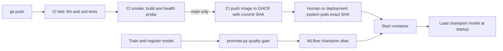

# Lab 5 — CI/CD with GitHub Actions

## Deliverables

- `.github/workflows/ci.yml` runs lint, unit tests, a Docker health smoke test, and a GHCR push for `main` commits.
- `src/food11/data.py` has pure helpers; `serve.py` can start with `SKIP_MODEL=1` and accepts a fake model in API tests.
- `tests/fixtures/bread.jpg` is a small Git-tracked fixture. Tests do not need DVC data, MLflow, or a GPU.
- `validate_data.py` checks the processed data contract. `scripts/repair_mini.py` replaced 43 pre-existing cross-split duplicate images with unique images from their original full-data splits. The mini dataset now passes all five checks.
- `promote.py` compares a candidate's test accuracy to the champion plus two standard errors, records tags, and assigns `champion` or `challenger`.

## Question 1 — Why avoid loading the real model in unit tests?

The test could fail because MLflow is offline, credentials or network access are unavailable, the model alias or artifacts are missing, or the model takes too long to download. These are infrastructure failures even if the API code is correct. A real model also makes a small unit test slow and dependent on changing registry state.

## Question 2 — What does the fake-model API test prove?

It proves that the endpoint accepts an uploaded image, decodes and preprocesses it, calls the model interface, maps the winning class to `Bread`, and returns a JSON category and confidence in `[0, 1]`. It does not prove that ResNet18 is accurate, that MLflow can load the real model, or that a production request has acceptable latency.

## Question 3 — Which check caught the duplicate, and why is it dangerous?

The `cross-split duplicates` check failed with exit code 1 when `training/Bread/0_0.jpg` was copied into `evaluation/Bread/lab5_duplicate.jpg`. The temporary copy was removed afterward. A train/test duplicate leaks a memorized example into evaluation and can inflate reported accuracy without a visible failure. A corrupted image usually produces an obvious processing error that can be fixed before trusting the result.

## Question 4 — Where can data validation run?

Run it locally just after `dvc pull` and before training. It can also run in a dedicated data CI job on a self-hosted runner with access to the DVC remote, or on a cloud runner with DVC credentials provided as secrets. The code-only CI jobs intentionally do not fetch the full dataset.

## Question 5 — Why does `smoke` use `needs: test`?

When a test fails, GitHub skips `smoke`; the deliberately failing PR demonstrated this. Without `needs`, the jobs could run independently and spend time building a container for broken code.

## Question 6 — First and second CI duration

The first full `main` run took 5 minutes 18 seconds, from 08:36:44 to 08:42:02 UTC. `test` took 23 seconds, `smoke` 46 seconds, and the GHCR `push` job 4 minutes.

For a like-for-like comparison without the main-only push, the first green branch run took 1 minute 17 seconds (08:40:44–08:42:01 UTC). An empty `ci` commit triggered a second branch run that took 1 minute 18 seconds (08:44:09–08:45:27 UTC). `uv sync --frozen` dropped from about 5 to 4 seconds, consistent with the enabled uv cache, but the one-second change is too small to separate from runner variation. `smoke` took 46 then 48 seconds because each fresh runner built the Docker image again; there was no meaningful whole-run speedup.

## Question 7 — Why tag the image with the commit SHA?

A SHA identifies the exact source revision used for an image. `latest` can be overwritten: machine A might pull it Monday, machine B on Tuesday after another build, and both would claim to run `latest` while running different code. The workflow publishes `ghcr.io/omarserhal8/mlops-lab-1:<commit-sha>`.

## Question 8 — Why limit `GITHUB_TOKEN` permissions?

Only the image publishing job needs `contents: read` and `packages: write`. A compromised step holding broad write permissions could modify repository contents or workflows, publish malicious packages, or tamper with releases. The limited token confines the job to the capabilities it needs.

## Question 9 — What did the broken PR show?

[PR #1](https://github.com/OmarSerhal8/mlops-lab-1/pull/1) initially had a deliberately wrong class assertion. Both `test` checks failed, `smoke` was skipped, and GitHub reported `mergeStateStatus: BLOCKED`. The rule requires a pull request and successful `test` and `smoke` checks on `main`. This gives the team a shared, enforced check rather than relying on every developer to remember local commands. The assertion was then fixed and pushed again.

## Question 10 — Promotion decisions

The current champion is Version 2, re-registered from the same weights as the original Lab 2 run. Its re-registration run lacked metrics, so `test_accuracy=0.820255` and `dataset=mini` were copied from the original run, with `metric_source_run_id` recorded as a tag on that run.

The mini evaluation split has 1,096 images. At champion accuracy `0.820255`, `2 × SE = 0.0232`, or 2.32 percentage points. A candidate must reach at least `0.8435` to become champion.

| Candidate | Test accuracy | Gate decision |
|---|---:|---|
| Version 3, learning rate 0.01, 1 epoch | 0.0876 | `challenger`; champion remains Version 2 |
| Version 4, learning rate 0.0001, 5 epochs | 0.8203 | `challenger`; champion remains Version 2 |

Version 4 matched the champion's test accuracy to the displayed precision but did not clear the 0.8435 threshold. After both decisions, `champion` still points to Version 2 and `challenger` points to Version 4 (the latest challenger).

The decision, both accuracies, threshold, and test size are stored as tags on each candidate version.

## Question 11 — How could promotion run automatically?

A training job on a self-hosted runner that can reach the local MLflow server could call `promote.py` after registering its model. Alternatively, move MLflow to a hosted service such as DagsHub and let a GitHub Actions training or promotion job call the script with the server URL and credentials supplied as secrets.

## Question 12 — Pipeline from push to container

The workflow automatically selects the code version by Git commit SHA on `main`. Deployment still needs someone or a separate deployment system to pull and run that SHA. The model version is selected independently by the promotion gate through the MLflow `champion` alias; changing the alias affects new service starts or explicit reloads.
